<p align="center">
  
</p>

<p align="center">
  
</p>

<p align="center">
  <a href="https://nevilpaul.com"></a>
  <a href="https://www.fiverr.com/nevilpaul"></a>
  <a href="mailto:contact@nevilpaul.com"></a>
  <a href="https://www.instagram.com/nevil_codex"></a>
</p>



## 🌸 自己紹介 ・ About me

```yaml
name:      Nevil Paul
role:      Full-Stack Developer & AI Automation Specialist
based_in:  Nairobi, Kenya
works_for: Clients worldwide 🌍
building:
  - SaaS products, from database to UI
  - n8n automations for business owners
  - Intercom & Fin AI support setups
  - AI agents for support, sales and onboarding
status:    Open for freelance & contract work ✨
```


## ⚔️ 技術 ・ Tech stack

<p align="center">
  <br/>
  
</p>

<p align="center">
  
  
  
  
</p>


## 📜 作品 ・ Featured projects

<table>
<tr>
<td width="50%" valign="top">

### 🛡️ [ClawAudit](https://github.com/NevilPaulO/clawaudit)
A cinematic control room for OpenClaw autonomy. See risks, checks, skills, schedules and safety signals before trusting unattended automation.


</td>
<td width="50%" valign="top">

### 🔗 [Pairhop](https://github.com/NevilPaulO/Pairhop-App)
App project in active development. More details coming soon.


</td>
</tr>
</table>


## ⚡ 統計 ・ Stats

<p align="center">
  
  
</p>

<p align="center">
  
</p>


## 💌 連絡 ・ Work with me

<p align="center">
  <b>Need a web app, an automation or an AI support setup?</b><br/>
  Let's build it together. 50+ happy clients on Fiverr.
</p>

<p align="center">
  <a href="https://www.fiverr.com/nevilpaul"></a>
  <a href="https://nevilpaul.com"></a>
</p>

<p align="center">
  
</p>
